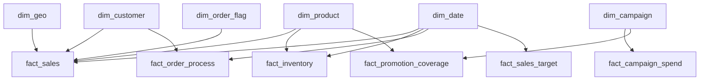
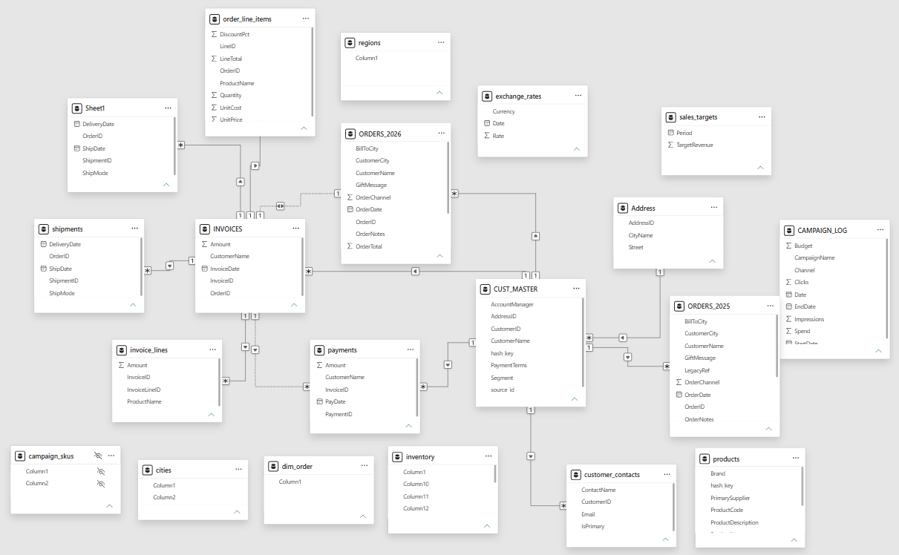
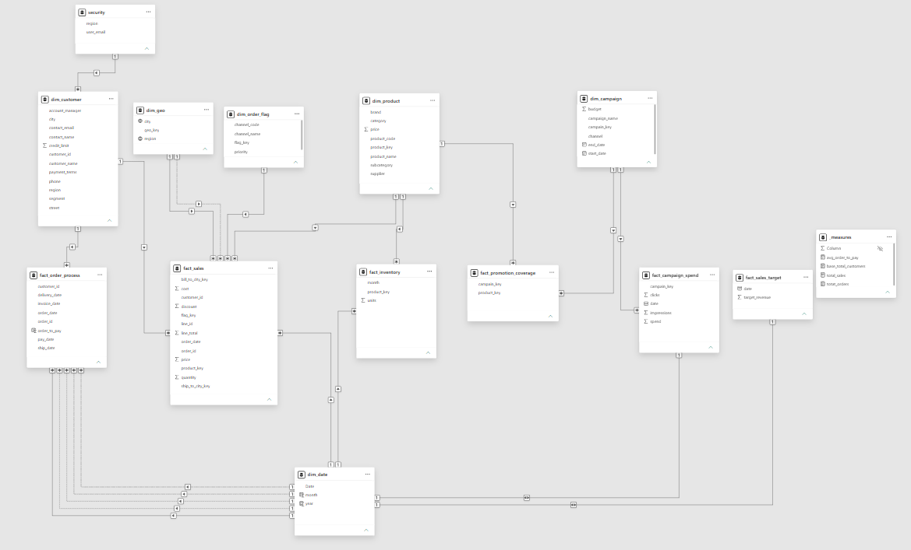

# Ultra Nightmare Data Modeling Project

> Turning a deliberately messy operational dataset into a clean, reporting-ready Power BI semantic model.

This repository documents an end-to-end Power BI data-modeling exercise based on the **Nightmare Data Model** portfolio tutorial. The project starts with a workbook containing disconnected, duplicated, inconsistently shaped operational tables and restructures the data into dimensions, fact tables, and a regional row-level security model.

The focus is the semantic model and the decisions behind it—not dashboard decoration.

## Project goals

- Understand the source system before changing its structure.
- Identify the grain of each source table and each analytical fact.
- Consolidate related source tables into business-friendly dimensions.
- Build fact tables at clearly defined grains.
- Replace the original tangled relationships with a controlled dimensional model.
- Validate row counts, uniqueness, relationships, and key totals after transformations.
- Apply and test regional Row-Level Security (RLS).
- Organize Power Query queries and use consistent naming conventions.

## Source and learning reference

The implementation follows the video tutorial:

**Power BI Data Modeling Portfolio Project End-to-End (Nightmare Data Model)**  
https://www.youtube.com/watch/0A2k62YEbfI

The included `transcipt.txt` file is the transcript reference used while documenting the project. The model work is based on the tutorial's workflow; this repository should be read as a hands-on implementation/learning project, not as an independently designed business solution.

## Repository contents

```text
.
├── dataset.xlsx
├── images/
│   ├── model-before.png
│   └── model-after.png
├── the_model.pbip
├── the_model.Report/
│   └── definition/
└── the_model.SemanticModel/
    ├── definition/
    │   ├── expressions.tmdl
    │   ├── model.tmdl
    │   ├── relationships.tmdl
    │   ├── roles/
    │   └── tables/
    └── diagramLayout.json
```

- **`dataset.xlsx`** — source workbook containing the original operational tables.
- **`the_model.pbip`** — Power BI Project entry point.
- **`the_model.SemanticModel/`** — semantic model definition, including Power Query (M), tables, relationships, measures, and the RLS role.
- **`the_model.Report/`** — report definition.
- **`transcipt.txt`** — tutorial transcript reference (if included in the repository).

Open `the_model.pbip` in a compatible version of Power BI Desktop. Keep the workbook at the path expected by the Power Query source expressions, or update the source path in Power Query before refreshing.

## Source workbook

The workbook contains operational source tables such as:

| Area | Source tables |
|---|---|
| Customers and addresses | `CUST_MASTER`, `customer_contacts`, `user_details`, `Address`, `cities`, `regions` |
| Products | `products`, `subcategories` |
| Orders and sales | `ORDERS_2025`, `ORDERS_2026`, `order_line_items`, `channels` |
| Fulfilment and payment | `shipments`, `INVOICES`, `invoice_lines`, `payments` |
| Marketing | `CAMPAIGN_LOG`, `campaign_skus` |
| Planning and inventory | `inventory`, `sales_targets` |
| Supporting/security | `security`, exchange-rate and auxiliary tables |

The source includes common modeling challenges: repeated descriptive attributes, different levels of detail, multi-row customer contacts, campaign SKU lists stored as delimited text, inventory stored in a wide month-by-month layout, and order data split across yearly tables.

## Modeling approach

The project follows four broad phases.

### 1. Preparation and investigation

- Inspect the source tables and understand the business entities.
- Establish the grain of each table before merging or reshaping it.
- Identify candidate dimensions, facts, and tables that do not add analytical value.
- Define naming and modeling standards.
- Record baseline counts and totals so that changes can be checked.

### 2. Build dimensions

The semantic model contains these business dimensions:

| Dimension | Purpose |
|---|---|
| `dim_customer` | Customer attributes, contact details, credit information, and customer geography |
| `dim_product` | Product, brand, subcategory, category, price, and supplier attributes |
| `dim_geo` | City and region lookup, used for geographic analysis |
| `dim_order_flag` | Order channel, status, and priority combinations |
| `dim_campaign` | Campaign descriptive attributes |
| `dim_date` | Calendar dimension used by date-based analysis |

Examples of transformation decisions include filtering a dummy customer record, consolidating customer and address context, generating surrogate keys for products and geography, and standardizing field names.

**Grain matters:** the customer-contact source has multiple contacts per customer. A direct merge at customer grain can multiply customer rows. The tutorial explores ways to handle this safely, including filtering to primary contacts or aggregating contacts before merging.

### 3. Build fact tables

The semantic model contains the following facts:

| Fact table | Analytical grain / purpose |
|---|---|
| `fact_sales` | One row per order line; sales quantity, price, cost, discount, line total, and dimension keys |
| `fact_inventory` | One row per product and month; inventory units |
| `fact_campaign_spend` | One row per campaign and campaign date; impressions, clicks, and spend |
| `fact_promotion_coverage` | One row per campaign-product combination |
| `fact_order_process` | One row per order; order, shipment, delivery, invoice, and payment dates |
| `fact_sales_target` | One row per target period; target revenue |

Notable transformations:

- The two yearly order sources are combined into a unified order query.
- Order-line details are enriched with order-header context to create the sales fact.
- Inventory is unpivoted from monthly columns into a product-month structure.
- Campaign SKU strings are split into individual campaign-product rows.
- Order, shipment, invoice, and payment dates are brought together for order-process analysis.

### 4. Model polishing and security

- Connect dimensions to facts using key-based relationships.
- Use inactive date relationships where a fact has multiple date roles (for example, order date, invoice date, ship date, and delivery date).
- Validate the model after relationship changes.
- Apply regional RLS through the customer dimension and the `security` mapping table.
- Test the role using representative user identities and confirm that each user sees only the permitted region.

## Model structure

At a high level, the model is a constellation/galaxy schema: multiple fact tables share conformed dimensions where appropriate.



The diagram is conceptual and omits inactive relationships and technical details. Consult `the_model.SemanticModel/definition/relationships.tmdl` for the actual relationship definitions.

## Before and after: model transformation

The screenshots below show the model before and after the data-modeling work. Add your screenshots to the repository's `images/` folder using the filenames shown here, or update the image paths to match your filenames.

| Before: original data model | After: redesigned semantic model |
|---|---|
|  |  |

<!-- Replace the image paths above with your actual screenshots if you use different filenames. -->

## Naming and modeling conventions

The project follows the conventions demonstrated in the tutorial:

- English names throughout the model.
- `snake_case` for table and column names.
- `dim_` prefix for dimensions.
- `fact_` prefix for facts.
- `_key` suffix for model-generated surrogate keys.
- Business-friendly names instead of source-system abbreviations where practical.
- Keep only columns that serve reporting, analysis, relationships, or model operations.
- Prefer a star-schema structure and avoid fact-to-fact relationships.
- Treat table grain and key uniqueness as non-negotiable validation checks.

## Measures currently defined

The checked-in semantic model currently includes these measures:

| Measure | Definition / intent |
|---|---|
| `total_sales` | Sum of `fact_sales[line_total]` |
| `totat_orders` | Distinct count of `fact_sales[order_id]` |
| `base_total_customers` | Count of customer IDs in `dim_customer` |
| `avg_order_to_pay` | Average order-to-payment duration |

The measure name `totat_orders` is the spelling currently present in the model file. Rename it to `total_orders` if you want to correct the typo, and update any dependent report references.

## Regional Row-Level Security

The model contains a role named **`Regional Access`**. Its table filter on `dim_customer` looks up the region assigned to the signed-in user:

```DAX
[region] =
    LOOKUPVALUE(
        security[region],
        security[user_email], USERPRINCIPALNAME()
    )
```

The security mapping table associates user email addresses with permitted regions. Test the role with Power BI's **View as** functionality and verify both restricted and unrestricted behavior before publishing.

## Validation checklist

Use this checklist when refreshing or extending the model:

- [ ] Confirm source row counts and key totals before and after transformations.
- [ ] Confirm dimension keys are unique and nonblank.
- [ ] Confirm each fact table has the intended grain.
- [ ] Check that merges do not unexpectedly multiply rows.
- [ ] Check unmatched foreign keys after dimension lookups.
- [ ] Reconcile sales totals against the source order-line data.
- [ ] Confirm inventory has one row per product-month.
- [ ] Confirm campaign coverage has one row per campaign-product pair.
- [ ] Test active and inactive date relationships.
- [ ] Review filter direction and avoid unnecessary bidirectional filtering.
- [ ] Test `Regional Access` with multiple user identities and regions.
- [ ] Refresh the PBIP project from a clean environment/path.

## Notes and known implementation details

This README describes the contents of the supplied project files. A few technical details are worth reviewing rather than silently assuming they are ideal:

- The semantic model includes six fact tables and six business dimensions, plus the `security` table and Power BI-generated date helper tables.
- `dim_campaign` and its foreign-key field are currently spelled `campain_key` in the model. Consider correcting this consistently if you revise the model.
- The relationship definition includes bidirectional filtering for the date-to-campaign-spend and date-to-sales-target relationships. Review whether that behavior is necessary for your intended analysis.
- Some date relationships are inactive because the order-process fact contains multiple date roles. Measures that analyze a non-active date role may need `USERELATIONSHIP()`.
- The project includes a `Regional Access` role, but RLS must still be tested in the target Power BI environment and configured appropriately after publishing.
- The report definition currently contains a single report page. The repository is primarily a data-modeling project rather than a multi-page dashboard showcase.

## Tools and technologies

- Microsoft Power BI Desktop
- Power Query (M)
- DAX
- Power BI Project format (PBIP)
- Tabular Model Definition Language (TMDL)
- Excel (`.xlsx`) as the source workbook

## Learning outcomes

This project demonstrates practical data-modeling skills:

- Source-system investigation and data profiling
- Fact and dimension identification
- Grain analysis
- Query staging and transformation organization
- Handling one-to-many source entities without row multiplication
- Unpivoting and normalizing operational data
- Surrogate-key creation and dimension lookups
- Fact-table construction
- Relationship design and role-playing dates
- Measure creation and reconciliation
- Regional row-level security

## Attribution

The project is a learning implementation based on the tutorial linked above. Credit for the tutorial's walkthrough and source scenario belongs to its creator. The README documents the supplied workbook and Power BI project files; it does not claim ownership of the original teaching material or dataset.
